# Procesverslag
Markdown is een simpele manier om HTML te schrijven.  
Markdown cheat cheet: [Hulp bij het schrijven van Markdown](https://github.com/adam-p/markdown-here/wiki/Markdown-Cheatsheet).

Nb. De standaardstructuur en de spartaanse opmaak van de README.md zijn helemaal prima. Het gaat om de inhoud van je procesverslag. Besteedt de tijd voor pracht en praal aan je website.

Nb. Door *open* toe te voegen aan een *details* element kun je deze standaard open zetten. Fijn om dat steeds voor de relevante stuk(ken) te doen.

## Jij

  
uitwerken voor kick-off werkgroep

  ### Auteur:
  Beyza Deniz

  #### Je startniveau:
  Blauw

  #### Je focus:
  Responsive
 

## Je website

  
uitwerken voor kick-off werkgroep

  ### Je opdracht:
  https://www.febo.nl/ 

  #### Screenshot(s) van de eerste pagina (small screen): 
  Homepagina  
  

  #### Screenshot(s) van de tweede pagina (small screen):
  Ons assortiment
  
 

## Toegankelijkheidstest 1/2 (week 1)

  
uitwerken na test in 2e werkgroep

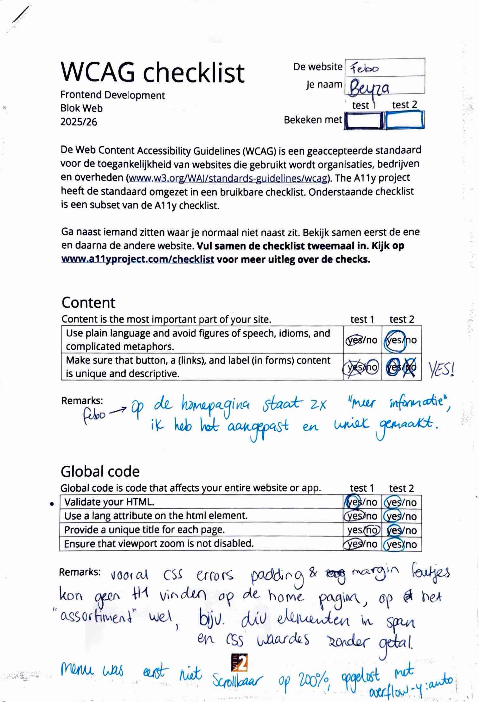
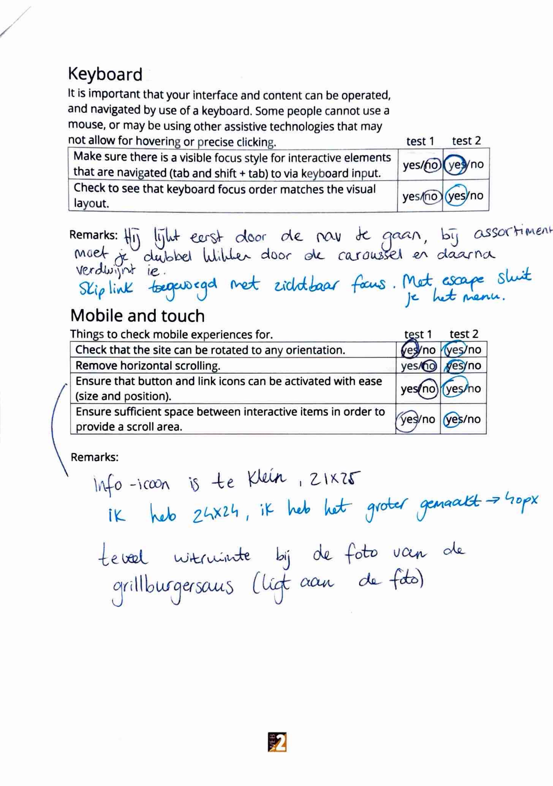
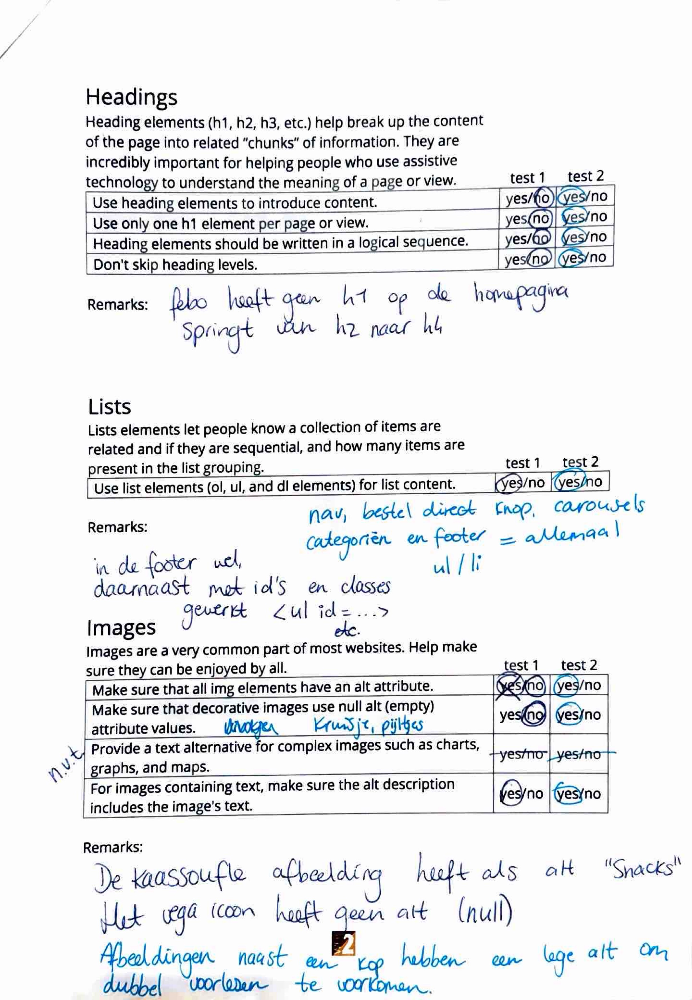
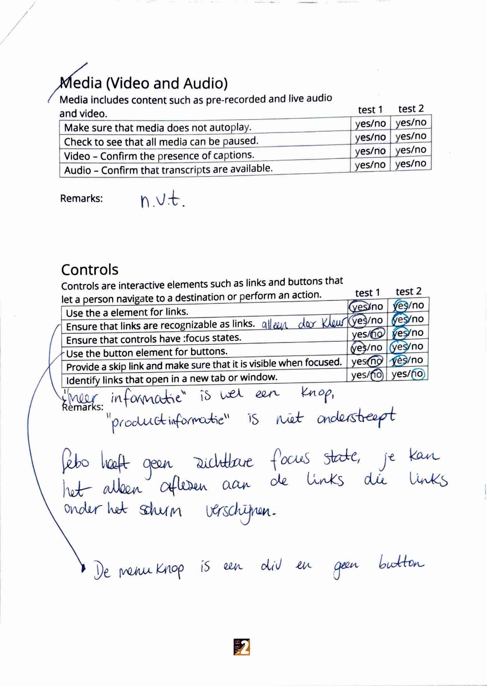
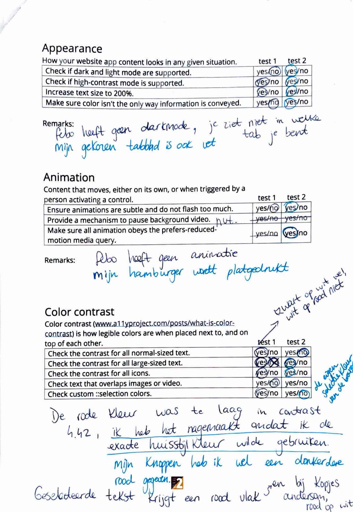

  ### Bevindingen
  Lijst met je bevindingen die in de test naar voren kwamen:

  Test 1 – febo.nl

  - Geen skip link en geen zichtbare focusstijl
  - Geen h1, niveaus overgeslagen (h2 → h4)
  - Vega-icoon zonder alt; nergens een lege alt voor decoratieve afbeeldingen
  - Hamburger-menuknop is een div en geen button; info-icoon niet met het toetsenbord bereikbaar en maar 21 × 25px
  - Links naar Google Maps en vestigingen openen in een nieuw tabblad zonder melding
  - Wit op FEBO-rood: contrast 4,42:1 (eis 4,5:1)
  - W3C-validator: veel errors, o.a. margin-bottom: px en div binnen span; ook errors in de Console

  Test 2 – mijn site: wat ik heb verbeterd na de test

  - Skip link toegevoegd
  - De twee links “Meer informatie” uniek gemaakt
  - Menu op 200% zoom scrollbaar gemaakt (height: calc(100dvh - 4rem) en overflow-y: auto)
  - Info-knop: padding: 0.5 zonder eenheid → 0.5rem, tikgebied ongeveer 40px
  - Kaassoufflé een alt gegeven
  - Foto’s van de kaarten even hoog gemaakt in landscape
  - Milkshake-error opgelost (ik had dezelfde afbeeldingen in meerdere mappen), 0 errors in de Console

  Wat al goed was:

  - één h1
  - alle afbeeldingen hebben een (lege) alt
  - de menuknop is een button met aria-expanded
  - dark mode
  - prefers-reduced-motion

## Breakdownschets (week 1)

  
uitwerken na afloop 3e werkgroep

  ### de hele pagina: 
  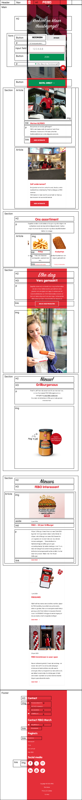

  ### dynamisch deel (bijv menu): 
  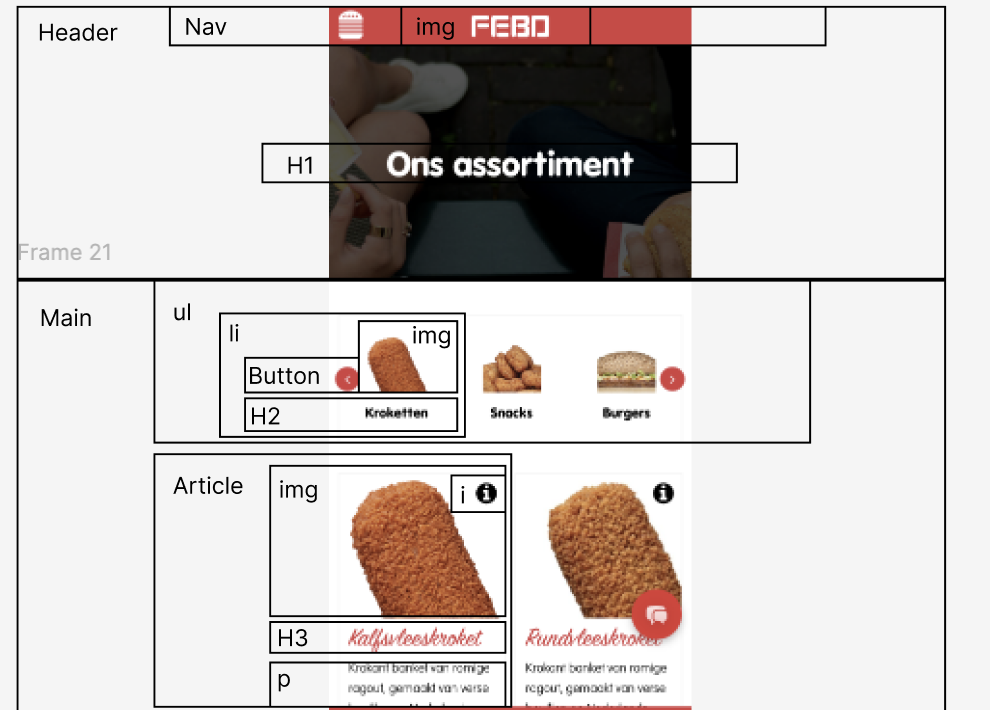

## Voortgang 1 (week 2)

  
uitwerken voor 1e voortgang

  ### Stand van zaken
   Ik was een beetje in de war met mijn oude html en nieuwe html, omdat ik bleef kijken naar mijn oude breakdownschets.

  ### Agenda voor meeting
  samen met je groepje opstellen

  | Michelle        | Lois               | Abdenour       | Ik                  |
  | ---             | ---                | ---            | ---                 |
  | Breakdownschets | Breakdownschets    | Goedkeuring    | Breakdown pagina 2  |
  | Animaties       | dit als er tijd is | website        | Oude html bekijken  |
  | ...             | ...                | WCAG checklist | ...                 |

  ### Verslag van meeting
  hier na afloop snel de uitkomsten van de meeting vastleggen

  - Ik ga mijn oude html aanpassen aan de hand van mijn nieuwe breakdownschets.
  - Het is eigenlijk beter om de code opnieuw te schrijven.
  - Dinsdag kan ik feedback krijgen op html van beide pagina's.
  - ...

## Voortgang 2 (week 3)

  
uitwerken voor 2e voortgang

  ### Stand van zaken
  Ik bleef nog vasthaken bij mijn breakdownschets, in plaats van verder te werken

  ### Agenda voor meeting
  samen met je groepje opstellen

  | Sander         | Mtima              | Dewi            | Ik               |
  | ---            | ---                | ---             |  ---             |
  | dit bespreken  | Micro interacties  | Breakdownschets | CSS              |
  | en dat ook nog | Carousel           | nog een punt    | Iconen           |
  | ...            | keyframes          | ...             | ...              |

  ### Verslag van meeting
  hier na afloop snel de uitkomsten van de meeting vastleggen

  - Mijn h1 was nog zichtbaar, ondanks visually hidden in mijn html. We hebben het gelinkt aan mijn CSS.
  - Ik mag andere icons gebruiken, omdat Febo zijn iconen met een lettertype heeft gemaakt.
  - <aside> aanpassen naar <time>

## Voortgang 3 (week 4)

  
uitwerken voor 3e voortgang

  ### Stand van zaken
  hier dit ging goed & dit was lastig (neem ook screenshots op van delen van je website en code)

  ### Agenda voor meeting
  samen met je groepje opstellen

  | Sander         | Dewi               | Mtima        | Ik               |
  | ---            | ---                | ---          | ---              |
  | dit bespreken  | en dit             | en ik dit    | en dan ik dat    |
  | en dat ook nog | dit als er tijd is | nog een punt | dit wil ik zeker |
  | ...            | ...                | ...          | ...              |

  ### Verslag van meeting
  hier na afloop snel de uitkomsten van de meeting vastleggen

  - punt 1
  - punt 2
  - nog een punt
  - ...

## Eindgesprek (week 5)

  
uitwerken voor eindgesprek

  ### Je uitkomst - karakteristiek screenshots:

  Mijn homepagina op een klein scherm
  

  Mijn homepagina op een groot scherm
  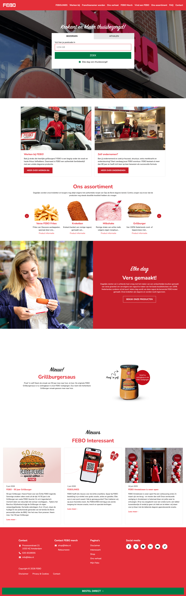

  Mijn assortimentpagina op een klein scherm
  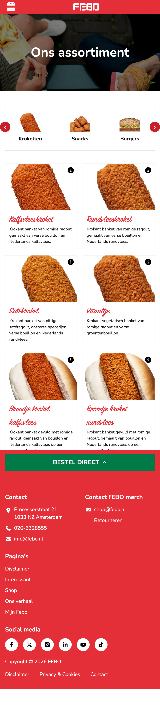

  Mijn assortimentpagina op een groot scherm
  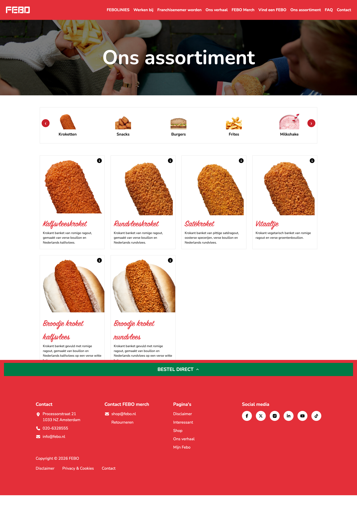

  De hamburger wordt platgedrukt, net zoals hoe het eruit ziet als je een hamburger zou eten
  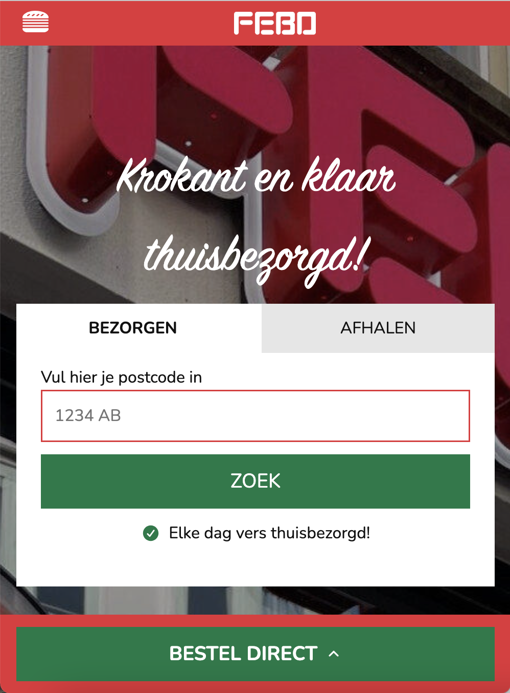

  Dark modus 
  
   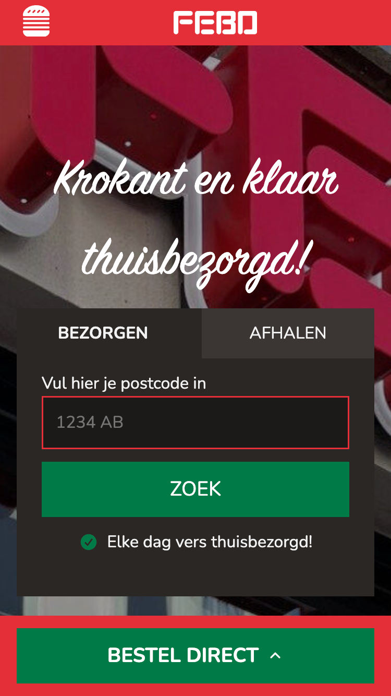

  ### Dit ging goed/Heb ik geleerd: 
  HTML zonder classes en divs: stylen met selectors als :has(), :nth-of-type() en >, en details element voor Bestel direct zonder JavaScript.

  Micro-interactie: een echte button met aria-expanded, sluiten met Escape, de hamburger die platgedrukt wordt, en uitgezet bij prefers-reduced-motion.

  Toegankelijkheid testen: contrast meten in DevTools, alt-teksten en koppen controleren in de Console, de W3C-validator. Mijn site is op veel punten beter dan febo.nl: skip link, één h1, button in plaats van div, dark mode etc.

  Zelf fouten gevonden dankzij de test: padding: 0.5 zonder eenheid, en een menu dat op 200% niet scrollde door min-height.

  Responsive: breakpoints in em, gekozen op de plek waar het ontwerp breekt en niet per apparaat.

  Debuggen: de Console lezen bij een 404, en harde verversing met Cmd+Shift+R.

  ### Dit was lastig/Is niet gelukt:
  Filter en info-knoppen op de assortimentpagina werken niet: bewuste keuze, geen JavaScript.

  Breakpoint van 94em: breder dan mijn eigen laptop, waardoor ik de laptopversie lang niet zag.

  Op 500% zoom bedekken de vaste header en de Bestel direct-balk het hele scherm.

  Contrast: wit op FEBO-rood haalt 4,42:1, bewust de huisstijlkleur gehouden.

  iCloud: mijn afbeeldingen laadden soms niet, omdat de bestanden niet op mijn laptop stonden.

  Planning: Ik heb veel moeten doen in een korte tijd en ik heb de meeste vooruitgang geboekt na de eerste kans.

## Bronnenlijst

  
continu bijhouden terwijl je werkt

  **Lesstof FED 25/26**
  1. FED 25/26 – De opdracht en beoordelingsformulier
  2. FED 25/26 – Slides Font services (Google Fonts)
  3. FED 25/26 – Intro :has() (o.a. slides "Kind met attribuut" en "Kind met status")
  4. FED 25/26 – Intro JS 3-stap (querySelector, onclick, classList, onkeydown)
  5. FED 25/26 – Intro animeren (@keyframes, transition, prefers-reduced-motion)
  6. FED 25/26 – Intro 5 flavours of positioneren (o.a. slide "De h3 rechtsboven")
  7. FED 25/26 – Oefening positioneren 1
  8. FED 25/26 – Oefening flexbox 3: flexy header
  9. FED 25/26 – Oefening flexbox 4: carousel (stap 1 scroll-snap, stap 2 ::scroll-button)
  10. FED 25/26 – Blok 1 WCAG checklist

  **Toegankelijkheid**
  11. The A11Y Project – Checklist: https://www.a11yproject.com/checklist/
  12. The A11Y Project – How-to: Hide content (visually-hidden): https://www.a11yproject.com/posts/how-to-hide-content/
  13. The A11Y Project – How-to: Use skip navigation links: https://www.a11yproject.com/posts/skip-nav-links/
  14. W3C Markup Validation Service: https://validator.w3.org/

  **MDN Web Docs**
  15. `
`: The Details disclosure element – https://developer.mozilla.org/en-US/docs/Web/HTML/Element/details
  16. appearance – https://developer.mozilla.org/en-US/docs/Web/CSS/appearance
  17. :focus-visible – https://developer.mozilla.org/en-US/docs/Web/CSS/:focus-visible
  18. object-fit – https://developer.mozilla.org/en-US/docs/Web/CSS/object-fit
  19. filter – https://developer.mozilla.org/en-US/docs/Web/CSS/filter
  20. Viewport units (dvh) – https://developer.mozilla.org/en-US/docs/Web/CSS/length#relative_length_units_based_on_viewport
  21. content – https://developer.mozilla.org/en-US/docs/Web/CSS/content
  22. calc() – https://developer.mozilla.org/en-US/docs/Web/CSS/calc
  23. overflow-y – https://developer.mozilla.org/en-US/docs/Web/CSS/overflow-y
  24. scroll-snap-stop – https://developer.mozilla.org/en-US/docs/Web/CSS/scroll-snap-stop
  25. CSS grid layout – https://developer.mozilla.org/en-US/docs/Web/CSS/CSS_grid_layout
  26. aria-expanded – https://developer.mozilla.org/en-US/docs/Web/Accessibility/ARIA/Attributes/aria-expanded
  27. aria-current – https://developer.mozilla.org/en-US/docs/Web/Accessibility/ARIA/Attributes/aria-current
  28. setAttribute(), classList.contains(), KeyboardEvent.key en focus() – https://developer.mozilla.org/en-US/docs/Web/API

  **Content, fonts en iconen**
  29. febo.nl – teksten, foto's en de hamburger-SVG: https://www.febo.nl/
  30. Google Fonts – Nunito: https://fonts.google.com/specimen/Nunito
  31. Font Awesome – iconen als SVG: https://fontawesome.com/
  32. SVG Repo – iconen: https://www.svgrepo.com/

  **AI en andere hulp**
  33. Claude (Anthropic) – uitleg en hulp bij: de opbouw en het opsplitsen van mijn CSS, de footer, de tabbladen Bezorgen/Afhalen, Bestel direct met details, het menu (JavaScript met aria-expanded en Escape), de micro-interactie, contrast, de carousels, de skip link, het voorbereiden en uitleggen van de toegankelijkheidstest, en het opsporen van fouten (o.a. menu niet scrollbaar op 200%, padding zonder eenheid, afbeeldingen die niet laadden door iCloud). Ik heb de code zelf getypt, aangepast en getest.

